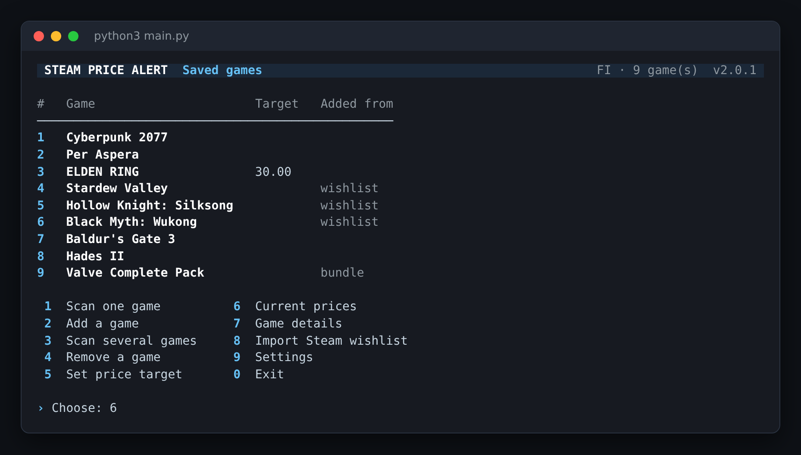
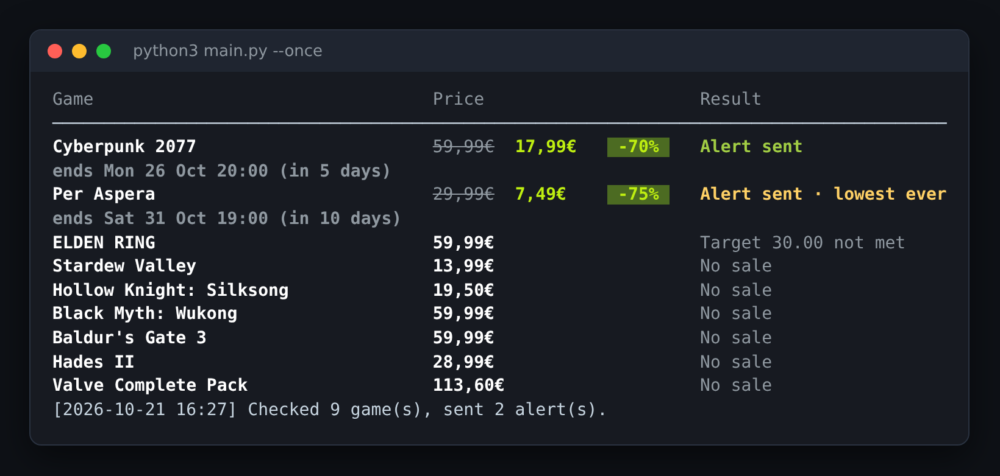
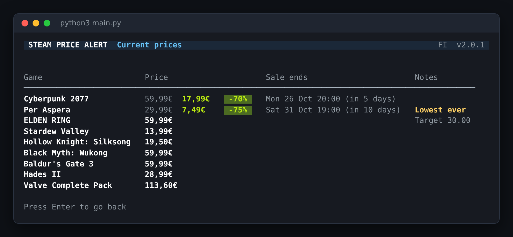
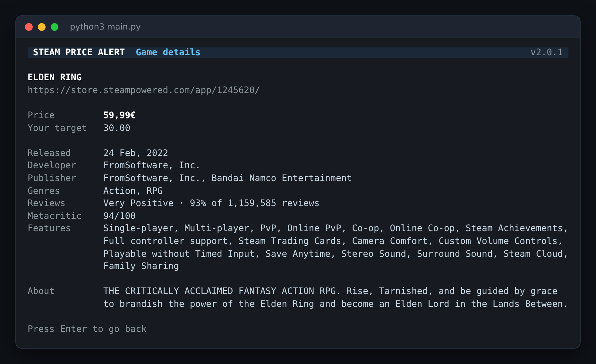
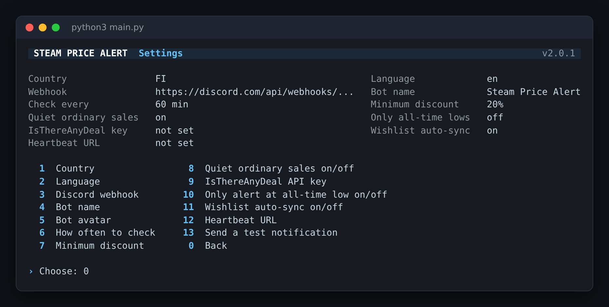

# Steam Game Price Alert

Watches the Steam games you care about and posts to your Discord channel when one goes on sale, drops to your target price, or hits its lowest price ever. Runs in a terminal or as a background service on a Linux server.



## Features

**Alerts**
- Discord alerts with the cover, sale price, normal price, discount, when the sale ends and the Steam review score
- Alerts found in the same check are grouped, up to 10 per message, so a big sale doesn't flood your channel
- Ordinary sales arrive silently; a met price target or a lowest-ever price notifies you
- Old alerts update themselves: "Sale ended", or "Now even cheaper" with a fresh alert
- Optional minimum discount, e.g. only sales of 50% or more
- Optional real all-time-low data from IsThereAnyDeal, plus an "only alert at the all-time low" mode

**What you can watch**
- Games, DLC, packages (`/sub/`) and bundles (`/bundle/`)
- Add by store link, app id or name search; adding a game offers to watch its DLC too
- Import your public Steam wishlist; auto-sync adds new wishlist games and removes ones you bought

**Built for a server**
- Background mode (`--daemon`) and single-check mode (`--once`, for cron)
- One Steam request checks up to 100 items; failed requests retry with a pause instead of hammering Steam
- Posts a warning to Discord after 3 failed checks in a row, and an all-clear when it recovers
- Optional heartbeat URL (e.g. healthchecks.io) so you hear about it even if the whole server is down
- A check that hangs exits after 15 minutes, so systemd or Docker restart the bot
- Ready-made systemd service and Docker setup

## Screenshots

**Background check**: sale end times, lowest-price detection, price targets



**Current prices** in your store's currency



**Game details**



**Settings**



## Requirements

- Linux with Python 3.8 or newer
- `requests` and `rich` (installed below)
- A Discord webhook: Discord server settings > Integrations > Webhooks > New Webhook > Copy URL

## Installation

```bash
git clone https://github.com/UnboundFate/Steam-Game-Price-Alert.git
cd Steam-Game-Price-Alert/Steam-Game-Price-Alert
pip install -r requirements.txt
python3 main.py
```

On first run it asks for:
- **Country code**: decides the store and currency (e.g. `US`, `GB`, `DE`, `FI`)
- **Language code**: e.g. `en`, `de`, `fr`
- **Discord webhook URL**
- **Bot name** and **avatar URL** (optional)

Everything can be changed later under Settings.

## Usage

| Option | What it does |
|---|---|
| 1. Scan one game | Watch one game on a timer |
| 2. Add a game | Store link (game, DLC, package, bundle), app id, or a name to search |
| 3. Scan several games | Watch several games, or type `all` |
| 4. Remove a game | Remove a game and its price history |
| 5. Set price target | Alert when the price drops to this amount (your store's currency; `0` removes it) |
| 6. Current prices | Every price at once, with sale end times and notes |
| 7. Game details | Price, all-time low, reviews, release date, developer, features |
| 8. Import Steam wishlist | Add every game on your public wishlist |
| 9. Settings | Everything below, plus "Send a test notification" |

### Settings

| Setting | Default | What it does |
|---|---|---|
| How often to check | 60 min | Minimum 10 minutes |
| Minimum discount | 0% | Ignore sales smaller than this |
| Quiet ordinary sales | on | Ordinary sales arrive without a sound; targets and lowest-ever prices still notify |
| IsThereAnyDeal API key | not set | Free key from [isthereanydeal.com/apps/my](https://isthereanydeal.com/apps/my/). Use the **API Key**, not the OAuth client ID or secret |
| Only alert at all-time low | off | Needs the IsThereAnyDeal key. Sale alerts only when the price matches Steam's all-time low |
| Wishlist auto-sync | off | Background mode adds new wishlist games and removes ones you bought or un-wishlisted. Games you added by hand are never removed |
| Heartbeat URL | not set | A [healthchecks.io](https://healthchecks.io) ping URL; you're warned if the bot stops checking |

### Importing your wishlist

Your wishlist must be public: Steam > Profile > Edit Profile > Privacy Settings > **Game details: Public**. Then choose option 8 and enter your profile link, custom URL name or SteamID64.

### Lowest price ever

Without IsThereAnyDeal, the bot only knows the prices it has seen itself, so it only says "lowest price ever" after it has also recorded a higher price for that game. With an IsThereAnyDeal key it uses Steam's real all-time low from day one.

## Run it in the background

Set up your settings and games with `python3 main.py` first.

```bash
python3 main.py --daemon   # check all games on a timer until stopped
python3 main.py --once     # check once and exit; exit code 2 means the check failed
```

### systemd

```bash
# edit YOUR_USER and the paths in the file first
sudo cp deploy/steam-price-alert.service /etc/systemd/system/
sudo systemctl daemon-reload
sudo systemctl enable --now steam-price-alert
journalctl -u steam-price-alert -f
```

### Docker

From the top folder of the repo:

```bash
docker compose run --rm steam-price-alert python main.py   # first time: settings + games
docker compose up -d                                       # run in the background
docker compose logs -f
```

Data is kept in the `steam-alert-data` volume. Set `TZ` in `docker-compose.yml` to your time zone.

## Files

```
Steam-Game-Price-Alert/
├── main.py           Menu and command line (--daemon, --once)
├── background.py     Background mode, health checks, wishlist sync
├── scanner.py        Price checks and alert decisions
├── steam_api.py      Steam store API: prices, bundles, wishlist, search, DLC
├── itad.py           IsThereAnyDeal all-time lows (optional)
├── notifier.py       Discord messages: grouping, silent sales, edits
├── ui.py             Terminal look
├── saved_games.py    Database: games, targets, price history, sent messages
├── saved_info.py     Settings
├── stop_spam.py      Which deals were already sent
├── utils.py          Links, validation, formatting
├── paths.py          Where data files are stored
└── requirements.txt
```

Created automatically next to the scripts (or in `STEAM_ALERT_DATA_DIR`), never commit these: `user_info.json` (holds your webhook and keys), `saved_games.db`, `sale_reminder.json`, `health.json`, `debug.log`.

## FAQ

**No Discord messages?**
Settings > Send a test notification. If Discord rejects it, check the webhook URL. Details are in `debug.log`.

**Why didn't my phone buzz for a sale?**
Quiet ordinary sales is on by default: the alert is in the channel, it just doesn't notify. Turn it off in Settings if you want every sale to notify.

**A game says "Coming soon".**
It isn't released yet. Keep it in the list; you'll get an alert if it launches with a discount.

**Upgrading from an older version?**
Your games, targets and price history are kept, and the database upgrades itself on first start.

## License

MIT. See [LICENSE](LICENSE).
